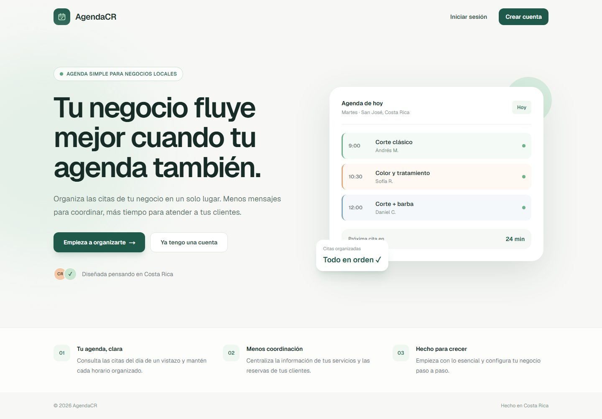
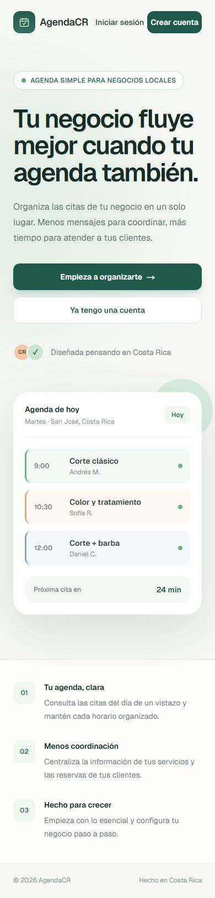
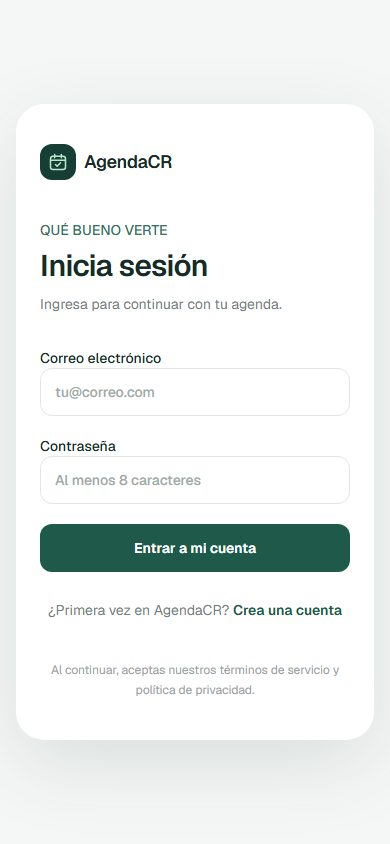
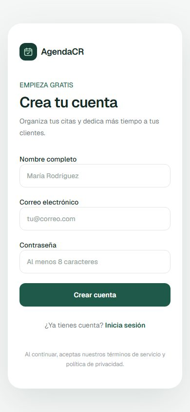
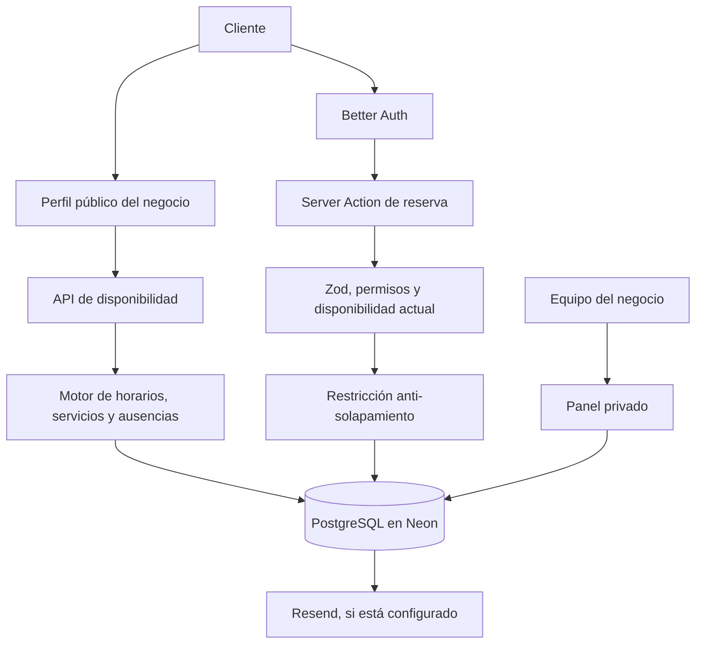

# AgendaCR

AgendaCR es una plataforma de reservas para negocios de servicios en Costa Rica. Los clientes pueden consultar servicios y horarios, solicitar una cita y revisar sus reservas. Cada negocio administra su agenda desde un espacio privado.

## Capturas

<table>
  <tr>
    <th>Página principal en escritorio</th>
    <th>Página principal en móvil</th>
  </tr>
  <tr>
    <td></td>
    <td></td>
  </tr>
  <tr>
    <th>Inicio de sesión en móvil</th>
    <th>Registro en móvil</th>
  </tr>
  <tr>
    <td></td>
    <td></td>
  </tr>
</table>

## Tecnologías

- Next.js 16 con App Router y React 19
- TypeScript estricto
- Tailwind CSS 4
- Better Auth para cuentas y sesiones
- PostgreSQL en Neon con Drizzle ORM
- Zod para validar datos en el servidor y formularios

## Requisitos

- Node.js 20.9 o superior
- npm
- Una base PostgreSQL en Neon

## Preparar el proyecto

1. Instala las dependencias:

   ```bash
   npm install
   ```

2. Crea un proyecto en Neon. En **Connect**, copia dos cadenas: con **Connection pooling** activado para `DATABASE_URL` (la aplicación) y desactivado para `DATABASE_URL_UNPOOLED` (las migraciones de Drizzle).

3. Abre `.env.local` en la raíz del proyecto y pega ambas cadenas en sus variables correspondientes:

   ```env
   DATABASE_URL=postgresql://...-pooler.../neondb?sslmode=require
   DATABASE_URL_UNPOOLED=postgresql://.../neondb?sslmode=require
   ```

   La clave aleatoria de `BETTER_AUTH_SECRET` ya se genera localmente al preparar el proyecto. Si necesitas crear otra, usa Node.js:

   ```bash
   node -p "require('node:crypto').randomBytes(32).toString('base64url')"
   ```

   Guarda el resultado en `BETTER_AUTH_SECRET`. No compartas ni subas `.env.local` al repositorio.

4. Aplica las migraciones a Neon:

   ```bash
   npm run db:migrate
   ```

   Esto crea las tablas y la restricción de PostgreSQL que impide citas solapadas para un mismo profesional.

5. Inicia la aplicación:

   ```bash
   npm run dev
   ```

   Abre [http://localhost:3000](http://localhost:3000).

## Flujo disponible

1. Crea una cuenta en `/registro`.
2. En `/inicio`, registra el negocio, agrega servicios y configura los horarios y ausencias.
3. Abre la página pública del negocio desde el panel. Su dirección usa el identificador del negocio: `http://localhost:3000/<slug>`.
4. Un cliente inicia sesión, selecciona un servicio y un espacio disponible, y envía la solicitud.
5. El dueño puede confirmar o cancelar la solicitud. Después de su hora de finalización, puede marcarla como completada o como inasistencia.

Las citas de clientes se cancelan en línea hasta dos horas antes. Los horarios se calculan en la zona horaria del negocio y se guardan como instantes UTC.

AgendaCR incluye un manifiesto web y un modo instalable. El service worker conserva recursos estáticos y muestra una página sin conexión; no almacena citas, sesiones ni respuestas de la API en caché.

Para sumar profesionales, envía una invitación desde la sección **Equipo** en `/inicio`. Si Resend está configurado, la persona recibirá un correo con un enlace de un solo uso; también puedes copiar el enlace desde el panel. La persona debe iniciar sesión o crear una cuenta con el correo invitado. El enlace vence en siete días. Tras aceptarlo, asigna los servicios que ofrecerá y configura su horario y ausencias desde el panel.

Los clientes pueden reportar pagos manuales por SINPE Móvil con monto y referencia desde **Mis citas**. El negocio verifica o rechaza cada reporte desde la agenda; un rechazo requiere explicar el motivo. AgendaCR no recibe ni mueve dinero y permite registrar varios abonos por cita.

## Decisiones importantes

### Arquitectura del flujo de reserva



- La disponibilidad se consulta en `/api/availability` y se vuelve a validar en el servidor al solicitar una cita.
- PostgreSQL aplica una restricción de exclusión para que dos solicitudes simultáneas no reserven el mismo horario del profesional. La migración personalizada está en `drizzle/`.
- Las acciones que modifican datos comprueban la sesión y que la persona tenga acceso al negocio o a la cita.
- Los intentos de inicio de sesión y registro, las consultas de disponibilidad, las reservas y las invitaciones tienen límites compartidos entre instancias, respaldados por Neon.
- Los servicios se desactivan para conservar el historial relacionado con citas anteriores.
- Las notificaciones de solicitud, confirmación y cancelación de citas usan Resend si se configuran `RESEND_API_KEY` y `RESEND_FROM_EMAIL`. Si faltan, las citas siguen funcionando sin enviar correos.
- El recordatorio automático se ejecuta cada hora en Vercel y busca citas confirmadas para dentro de 24 horas. Configura `CRON_SECRET` en Vercel para proteger el endpoint del cron.
- Al configurar `RESEND_API_KEY` y `RESEND_FROM_EMAIL`, Better Auth exige verificar el correo al registrarse y vuelve a solicitar un enlace si una persona intenta iniciar sesión sin verificarlo. El enlace vence en una hora y, al abrirlo, la cuenta inicia sesión automáticamente. Sin las credenciales de Resend, la verificación queda desactivada para que el desarrollo local siga funcionando. Para enviar invitaciones del equipo, configura esas mismas variables; si faltan, el enlace se puede compartir manualmente.

- El texto secundario del tema mantiene contraste suficiente sobre superficies claras, los cambios de disponibilidad se anuncian a lectores de pantalla y el calendario usa una lista semanal en pantallas estrechas.

## Comandos útiles

| Comando                    | Uso                                                                     |
| -------------------------- | ----------------------------------------------------------------------- |
| `npm run dev`              | Servidor local de desarrollo                                            |
| `npm run build`            | Compilación de producción                                               |
| `npm run start`            | Servidor de producción local                                            |
| `npm run lint`             | Revisión de ESLint                                                      |
| `npm run typecheck`        | Comprobación de TypeScript                                              |
| `npm test`                 | Ejecutar las pruebas unitarias                                          |
| `npm run test:e2e`         | Probar páginas públicas y formularios en Chromium de escritorio y móvil |
| `npm run test:e2e:booking` | Probar registro y reserva completa usando solo la rama Neon de pruebas  |
| `npm run format`           | Formatear archivos con Prettier                                         |
| `npm run format:check`     | Verificar formato                                                       |
| `npm run db:generate`      | Generar una migración desde el esquema                                  |
| `npm run db:migrate`       | Aplicar migraciones pendientes                                          |
| `npm run db:studio`        | Abrir Drizzle Studio                                                    |
| `npm run test:db`          | Probar la concurrencia en una rama Neon aislada                         |

La prueba `test:db` requiere `DATABASE_TEST_URL` en `.env.local`, con una rama de Neon separada de `DATABASE_URL` y las migraciones aplicadas. Comprueba que PostgreSQL permita solo una de dos reservas simultáneas para el mismo profesional y horario, y elimina sus registros al terminar. No la ejecutes contra la rama con datos reales.

La prueba `test:e2e:booking` también requiere `DATABASE_TEST_URL` y valida el flujo desde el registro hasta la creación de una cita. Crea y borra un negocio, una cuenta y una cita temporales en esa rama. El comando se detiene si detecta que la rama de pruebas y la principal tienen el mismo host. No forma parte del CI porque depende de esa base de datos aislada.

Las pruebas de navegador verifican navegación, etiquetas accesibles, validación local de acceso y desbordamiento horizontal en escritorios y móviles. El flujo aislado de reserva también revisa a 320 px el panel del negocio y la vista de lista del calendario. La prueba completa de reserva con datos reales debe usar una rama Neon exclusiva para pruebas.

La primera vez, instala el navegador de pruebas con `npx playwright install chromium`.

## Variables de entorno

| Variable                | Requerida       | Descripción                                                                   |
| ----------------------- | --------------- | ----------------------------------------------------------------------------- |
| `DATABASE_URL`          | Sí              | Cadena agrupada de Neon para la aplicación                                    |
| `DATABASE_URL_UNPOOLED` | Sí              | Cadena directa de Neon para las migraciones de Drizzle                        |
| `DATABASE_TEST_URL`     | Solo pruebas DB | Cadena de una rama Neon aislada para `npm run test:db`                        |
| `BETTER_AUTH_SECRET`    | Sí              | Clave aleatoria de al menos 32 caracteres                                     |
| `BETTER_AUTH_URL`       | Sí              | URL base de la aplicación; localmente `http://localhost:3000`                 |
| `APP_TIMEZONE`          | No              | Zona horaria predeterminada, `America/Costa_Rica`                             |
| `RESEND_API_KEY`        | No              | Clave de Resend para notificaciones de citas                                  |
| `RESEND_FROM_EMAIL`     | No              | Remitente autorizado en Resend, por ejemplo `AgendaCR <citas@tu-dominio.com>` |
| `CRON_SECRET`           | No              | Secreto aleatorio para autenticar el cron de recordatorios                    |
| `AI_API_KEY`            | No              | Reservada para una fase futura                                                |
